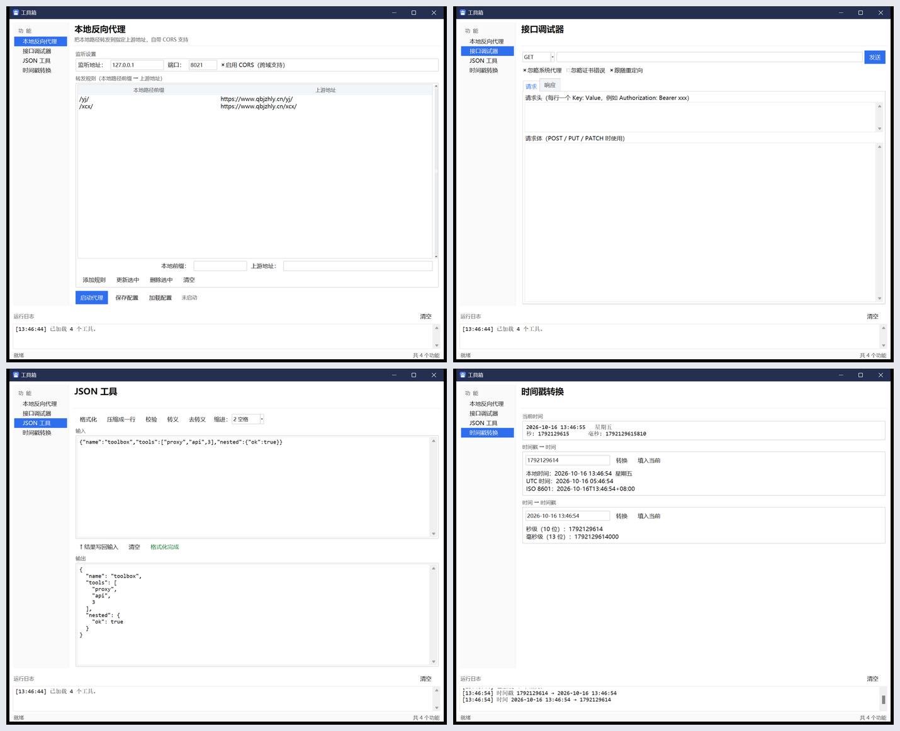

<p align="center">
  
</p>

# 工具箱（Toolbox）

一个用 Python + Tkinter 写的本地工具箱，采用**插件式架构**：主程序只负责左侧功能列表、右侧面板和底部日志，具体功能以插件形式放在 `tools/` 目录下，**丢进去就自动被发现**，无需改动主程序。

当前内置功能：

- **本地反向代理** —— 本地路径转发到上游地址，自带 CORS 支持
- **接口调试器** —— mini Postman，发请求、看状态码与 JSON 响应
- **JSON 工具** —— 格式化 / 压缩 / 校验 / 转义 / 去转义
- **时间戳转换** —— 时间戳与时间互转



## 特性

- **零第三方依赖**：只用 Python 标准库（`tkinter` + `http.server` + `http.client`）。
- **插件式扩展**：新增功能 = 在 `tools/` 下加一个模块。
- **界面与逻辑分离**：代理引擎不依赖界面，可被 Web / 命令行等其它前端复用。
- **配置隔离**：每个工具独立配置文件，互不干扰。
- **统一主题**：配色、字体、控件样式集中在 `core/theme.py`，改一处全局换肤。
- **可调分栏**：工具面板与运行日志之间的分界线可以拖动。

## 目录结构

```
toolbox/
├─ main.py                     主程序：功能列表 + 面板 + 共享日志
├─ run_toolbox.bat             双击启动（Windows）
├─ assets/                     图标资源
│  ├─ icon.ico / icon.png      应用图标（窗口 / 任务栏 / exe）
│  └─ make_icon.py             图标生成脚本（改配色在这里改）
├─ core/
│  ├─ base.py                  BaseTool 基类 + ToolContext + 资源路径
│  ├─ registry.py              按清单 + 自动扫描发现工具
│  └─ theme.py                 统一主题：配色 / 字体 / 控件样式
└─ tools/                      每个子目录 = 一个功能插件
   ├─ __init__.py              TOOL_MODULES 工具清单（新增工具要登记）
   ├─ proxy/                   本地反向代理
   │  ├─ config.py             配置数据模型
   │  ├─ engine.py             代理引擎（纯逻辑，不依赖界面）
   │  └─ tool.py               界面层
   ├─ api_tester/              接口调试器
   │  ├─ client.py             请求发送（纯逻辑，不依赖界面）
   │  └─ tool.py               界面层
   ├─ json_tool/               JSON 工具
   └─ timestamp/               时间戳转换
```

## 运行

需要 Python 3.8+（且安装时勾选了 `tcl/tk`，Windows 官方安装包默认包含）。

```bash
py toolbox/main.py
```

或双击 `toolbox/run_toolbox.bat`。

## 内置功能

### 本地反向代理

把本地路径转发到指定上游地址，常用于解决前端开发时的跨域问题。

1. **监听设置**：填监听地址（默认 `127.0.0.1`）和端口（默认 `8021`），按需勾选"启用 CORS"。
2. **转发规则**：填"本地路径前缀 → 上游地址"，例如
   - `/xcx/` → `https://www.example.com/xcx/`
   - `/api/` → `https://api.example.com/v1/`
3. 点 **启动代理**，然后前端直接请求 `http://localhost:8021/...` 即可。

### 关于 CORS

浏览器判断"同源"看 `协议 + 域名 + 端口` 三者是否完全一致。前端在 `:8020`、代理在 `:8021` 时端口不同，仍属跨域。勾选"启用 CORS"后，代理会：

- 自行应答 `OPTIONS` 预检请求（绕开上游重定向导致的预检失败）；
- 给响应补上 `Access-Control-Allow-*` 头。

### 接口调试器

一个轻量 Postman：填方法、URL、请求头（每行一个 `Key: Value`）和请求体，点发送即可查看状态码、耗时、响应头和响应体（JSON 自动美化）。

请求在后台线程发送，界面不会卡住。可选项：

- **忽略系统代理**：默认开启，避免本机代理干扰本地调试；
- **忽略证书错误**：测试自签名证书的 https 服务时打开；
- **跟随重定向**：默认开启。

### JSON 工具

格式化（可选 2 空格 / 4 空格 / Tab 缩进）、压缩成一行、校验合法性、转义 / 去转义。

### 时间戳转换

- 实时显示当前时间与秒级 / 毫秒级时间戳；
- 时间戳 → 时间：支持 10 位（秒）和 13 位（毫秒），输出本地时间、UTC、ISO 8601；
- 时间 → 时间戳：支持 `2026-10-16 11:30:00` 等常见格式。

## 如何新增一个工具

在 `tools/` 下新建模块，定义 `BaseTool` 子类即可：

```python
from core.base import BaseTool
from tkinter import ttk

class MyTool(BaseTool):
    id = "my_tool"
    name = "我的工具"
    order = 30                      # 侧栏排序，越小越靠前

    def build(self, parent):        # 构建界面，返回一个 Frame
        f = ttk.Frame(parent)
        ttk.Label(f, text="Hello").pack()
        return f

    def start(self): ...            # 可选：启动服务
    def stop(self): ...             # 可选：停止服务

    @property
    def running(self):              # 运行中侧栏会显示 ●
        return False
```

日志用 `self.log("...")`（线程安全，输出到底部共享日志）；配置文件路径用 `self.context.config_path("my_tool")`。

> **记得登记**：把模块名加入 `toolbox/tools/__init__.py` 的 `TOOL_MODULES` 列表。
> 源码运行时即使不登记也能靠自动扫描发现，但打包成 exe 后必须靠这份清单才能被收录。

## 打包为 exe

```bash
py -m pip install pyinstaller
py build_exe.py                    # 生成 dist/Toolbox.exe
py build_exe.py --name 工具箱       # 自定义名字
py build_exe.py --console          # 保留控制台，便于看报错
```

产物在 `dist/<名字>.exe`，单文件、免装 Python。

> **为什么不用直接跑 PyInstaller？**
> 工具箱的功能是运行时动态加载的，PyInstaller 的静态分析发现不了，
> 必须显式声明 `--hidden-import`。`build_exe.py` 会自动读取 `TOOL_MODULES`
> 清单逐个加上，以后新增工具无需改动打包命令。
> 另外 PyInstaller 冻结后 `pkgutil` 无法枚举已打包模块，所以清单是打包版的唯一可靠来源。

## 其它

仓库根目录还保留了早期版本的单文件脚本：

- `proxy.py`：只做转发、规则写死的简易代理；
- `proxy_gui.py`：带图形界面的单文件版代理工具。

`toolbox/` 是重构后的推荐版本。

## License

未指定。如需开源请自行添加 LICENSE 文件。
